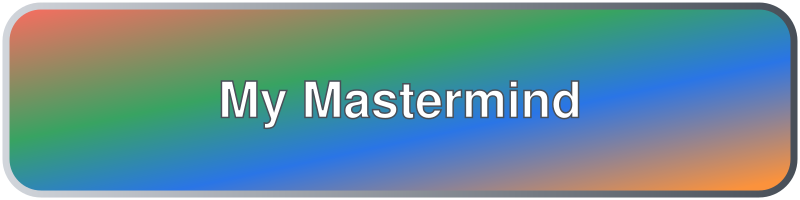
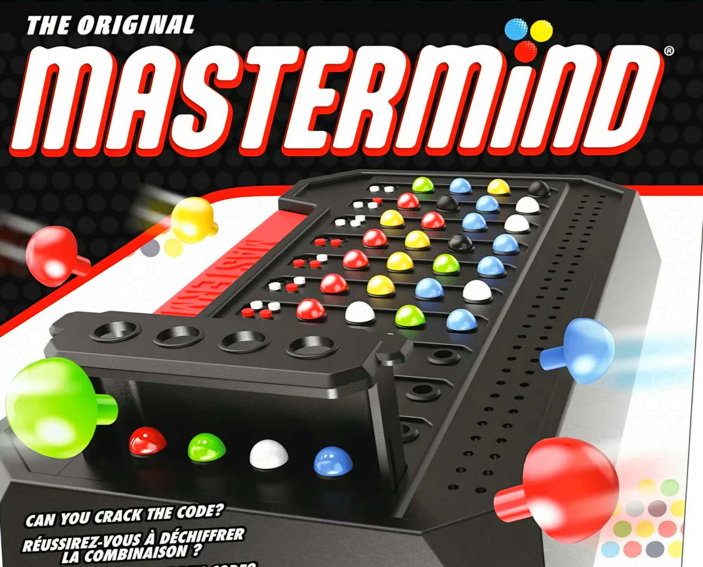
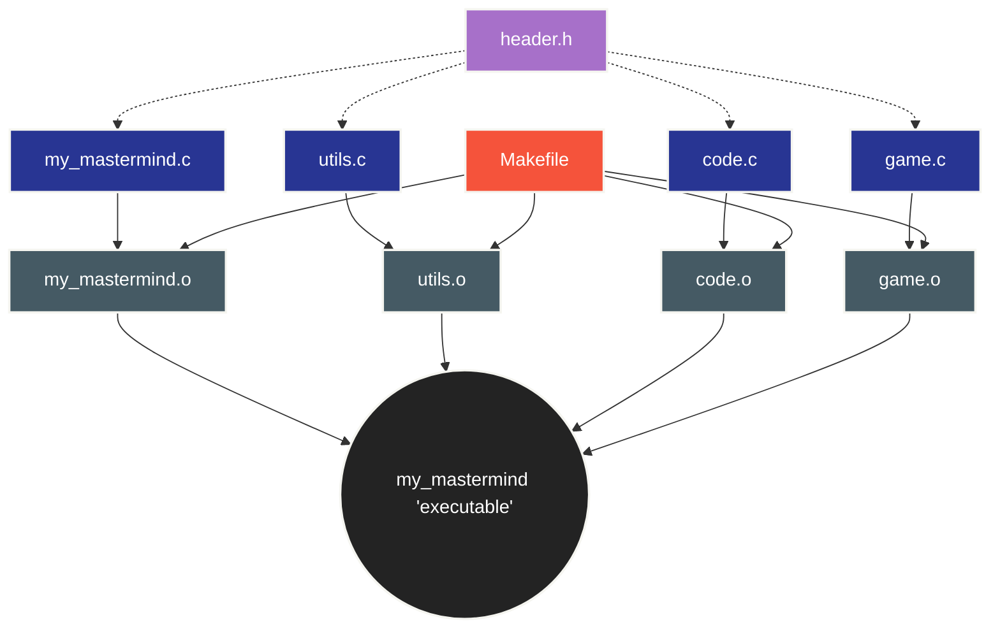

<p align="center">

</p>

<br />

<div align="center">

<a href="https://docs.getbifrost.ai/deployment-guides/how-to/install-make" target="_blank" rel="noopener">
  
</a>

<a href="https://koor.fr/C/Tutorial/Qualificateurs.wp" target="_blank" rel="noopener">
  
</a>

<a href="https://koor.fr/C/Tutorial/Index.wp" target="_blank" rel="noopener">
  
</a>

</div>

<br />
<br />
<br />
<br />
<br />
<br />

<div align="center">

# Mastermind

<br />



<br/>

*"Mastermind Board Game"*

</div>

<br />
<br />

<div align="center">

## {🗂️}\ Summary

<br />

<h3>
  <a href="#context" style="text-decoration: none;">
    <kbd style="font-size: 0.9em; padding: 0.3em 0.6em; font-weight: bold;">Context</kbd>
  </a>
</h3>


<br />

<h3>
  <a href="#guide" style="text-decoration: none;">
    <kbd style="font-size: 0.9em; padding: 0.3em 0.6em; font-weight: bold;">Guide</kbd>
  </a>
</h3>

<br />

<h3>
  <a href="#more-information" style="text-decoration: none;">
    <kbd style="font-size: 0.9em; padding: 0.3em 0.6em; font-weight: bold;">More Information</kbd>
  </a>
</h3>

<br />

<h3>
  <a href="#download" style="text-decoration: none;">
    <kbd style="font-size: 0.9em; padding: 0.3em 0.6em; font-weight: bold;">Download</kbd>
  </a>
</h3>

<br />

<h3>
  <a href="#future" style="text-decoration: none;">
    <kbd style="font-size: 0.9em; padding: 0.3em 0.6em; font-weight: bold;">Future</kbd>
  </a>
</h3>

<br />

<h3>
  <a href="#credits" style="text-decoration: none;">
    <kbd style="font-size: 0.9em; padding: 0.3em 0.6em; font-weight: bold;">Credits</kbd>
  </a>
</h3>

<br />
<br />

> Clickable Buttons !

</div>

<br />
<br />


<div align="center">

<h2 id="context">{📚}\ Context</h2>

</div>

<br />

> ---
>
> A client requested a **custom terminal-based Mastermind game**, in which players must crack a **4-character secret code** composed of **digits ranging from `0` to `8`**. The application requires a **round-based attempt system** and **input validation** to handle **invalid user input** without **consuming an attempt**. To meet these requirements with low-level control, **I chose to develop the game in C**.
>
> **Mastermind is a board game for two players**. The **goal** is to **guess** the **colours** and **positions** of **four or five pegs** within **`10` or `12` attempts**.
>
> However, the **project specifications** require a terminal-based game in which the player must crack a **four-character code** made up of digits from **`0` to `8`**, with a **default limit of `10` attempts**.
>
> ---

<br />

<div align="center">


<br />

*"C Language Logo"*


<br />
<br />

<h2 id="guide">{📖}\ Guide</h2>

</div>

<br />

> <a href="https://docs.getbifrost.ai/deployment-guides/how-to/install-make" target="_blank" rel="noopener">
>  
> </a>
> <br>
> <br>
> 
> First, I created a **`Makefile`** to compile the project using **`gcc`** with strict warning flags (**"`-Wall -Wextra -Werror`"**). These flags enable **compiler warnings and treat them as errors**. The Makefile also creates the **"`my_mastermind`" executable**.
> <br>
>
> #### Compilation & Build
>
> The project includes a **Makefile** to handle compilation with **`gcc`**. To improve **code quality** and **detect potential** issues **during compilation**, the project uses the **following compiler flags: "`-Wall -Wextra -Werror`"**.
> <br>
>
> #### Available Rules:
>
> * **`make`: Compiles the project** and generates the **"`my_mastermind`" executable**.
> <br>
>
> * **`make clean`:** **Removes object files** (**`.o`**).
> <br>
>
> * **`make fclean`:** **Removes object files** and the **generated executable**.
> <br>
> 
> * **`make re`:** Performs a **clean re-compilation**.

```Makefile
CC = gcc
CFLAGS = -Wall -Wextra -Werror

NAME = my_mastermind

SRCS = my_mastermind.c utils.c code.c game.c

OBJS = $(SRCS:.c=.o)

all: $(NAME)

$(NAME): $(OBJS)
	$(CC) $(CFLAGS) $(OBJS) -o $(NAME)

%.o: %.c header.h
	$(CC) $(CFLAGS) -c $< -o $@

clean:
	rm -f $(OBJS)

fclean: clean
	rm -f $(NAME)

re: fclean all

.PHONY: all clean fclean re
```

<br />
<br />
<br />
<br />

> <a href="https://koor.fr/C/Tutorial/Qualificateurs.wp" target="_blank" rel="noopener">
>  
> </a>
> <br>
> <br>
> 
> Next, I created a **custom header** file (**header.h**) to keep the codebase organized. It includes **essential standard libraries** (**`<stdio.h>, <stdlib.h>, <unistd.h>, <string.h>, <time.h>`** and **`<limits.h>`**). and centralizes **key game parameters** such as **CODE_SIZE**, **DEFAULT_ATTEMPTS**, and **VALID_PIECES**. It also declares the **prototypes for utility functions** (**"`my_strlen()`** and **`my_atoi()`"**) and **core game functions** (**"`is_valid_code()`**, **`generate_random_code()`**, **`evaluate_guess ()`**, and **`read_guess()`"**). By **including this header** in **source files**, the **implementation code** remains **clean** and **focused** strictly on the **game's execution logic**.
> <br>
>
>#### Standard Libraries Included:
>
> * **`<stdio.h>`:** Standard **Input/Output operations**.
> <br>
>
> * **`<stdlib.h>`:** Provides **standard utility functions**, including **"`rand()`"** and **"`srand()`"** for **pseudo-random number generation**.
> <br>
>
> * **`<unistd.h>`:** Low-level **POSIX system calls** such as **"`read()`"** and **"`write()`"**.
> <br>
>
> * **`<string.h>`**: Provides **string manipulation functions**, including **"`strcmp()`"**, which is used to compare **command-line arguments**.
> <br>
>
> * **`<time.h>`:** **Time utilities** used to seed the **pseudo-random number generator**.
> <br>
>
> * **`<limits.h>`**: Defines **integer limits** such as **"`INT_MAX`"**, which is used to **detect integer overflow** in **"`my_atoi()`"**.
> <br>
>
> #### Constants & Configuration:
>
> * **`CODE_SIZE` (4):** **Length** of the **secret code**.
> <br>
>
> * **`DEFAULT_ATTEMPTS` (10):** Default **number** of **rounds/attempts** available to the **player**.
> <br>
>
> * **`VALID_PIECES ("012345678")`:** Defines the **digits used** for **random secret-code generation**.
> <br>
>
> #### Prototypes:
>
> * **String Helpers:** **"`my_strlen`**, **`my_atoi`"**.
> <br>
>
> * **Game Logic:** **"`is_valid_code`, `generate_random_code`, `evaluate_guess`, `read_guess`"**.

> [!NOTE] 
> Including **`header.h`** in **`.c` files** avoids **cluttering** the implementation logic with repetitive includes and definitions, keeping the **main game logic concise and readable**.

```c
#ifndef HEADER_H
#define HEADER_H

#include <stdio.h>
#include <stdlib.h>
#include <unistd.h>
#include <time.h>
#include <limits.h>
#include <string.h>

#define CODE_SIZE 4
#define DEFAULT_ATTEMPTS 10
#define VALID_PIECES "012345678"

int my_strlen(const char *str);
int my_atoi(const char *str);
int is_valid_code(const char *code);
char *generate_random_code(void);

void evaluate_guess(const char *secret, const char *guess,
    int *well_placed, int *misplaced);

int read_guess(char *buffer);

#endif
```

<br />
<br />
<br />
<br />

> ---
>
> 
>Finally, I implemented the **core game logic in pure C**, focusing on **modularity, clear code organization, and input validation**
>
> 
> ---

<br />

> <a href="https://koor.fr/C/Tutorial/Index.wp" target="_blank" rel="noopener">
>  
> </a>
>
> <br />
>
> ### " my_mastermind.c " : 
> 
> This file contains the **main function** of the **Mastermind game**. It manages the **game settings**, checks the **secret code**, and handles the **player's attempts**.
>
>First, the program reads the **command-line arguments**. The **`-c`** option allows the user to provide a **custom secret code**, while the **`-t`** option sets the **maximum number** of attempts. **Both options are optional and can be used together**. The program **rejects duplicate options, missing arguments, and unknown options**. It also checks that the **number of attempts** is a **positive integer containing digits only and that the custom secret code contains exactly four digits between `0` and `8`**. If no secret code is provided, the program **generates a random one**.
>
> The program then displays a **welcome message and starts the game loop**. At each round, it asks the player to enter a guess. The **"`read_guess()`"** function **reads the input**, and **"`is_valid_code()`"** checks whether it contains exactly **four characters**, all of which are digits between **`0` and `8`**. **Repeated digits are allowed**. If the **input is invalid**, the program **displays "Wrong input!"** and asks the player to try again without consuming an attempt.
>
> If all **four digits are correct and in the right positions**, the **player wins**, and the program **displays a congratulatory message**.
>
> Otherwise, the program displays the **results and continues** to the **next round** until the **maximum number of valid attempts** is **reached**. If the player does not **guess the code in time**, the **program displays a loss message and reveals the secret code**.

```C
#include "header.h"

int main(int argc, char **argv)
{
    char *secret_code = NULL;
    int max_attempts = DEFAULT_ATTEMPTS;
    int attempt = 0;
    int well_placed;
    int misplaced;
    int argument_index = 1;
    int code_provided = 0;
    int attempts_provided = 0;
    char guess[CODE_SIZE + 1];

    while (argument_index < argc) {
        if (strcmp(argv[argument_index], "-c") == 0) {
            if (code_provided || argument_index + 1 >= argc) {
                printf("Error: invalid -c argument!\n");
                return 1;
            }
            secret_code = argv[argument_index + 1];
            if (!is_valid_code(secret_code)) {
                printf("Error: invalid secret code!\n");
                return 1;
            }
            code_provided = 1;
            argument_index += 2;
        } else if (strcmp(argv[argument_index], "-t") == 0) {
            if (attempts_provided || argument_index + 1 >= argc) {
                printf("Error: invalid -t argument!\n");
                return 1;
            }
            max_attempts = my_atoi(argv[argument_index + 1]);
            if (max_attempts <= 0) {
                printf("Error: invalid number of attempts!\n");
                return 1;
            }
            attempts_provided = 1;
            argument_index += 2;
        } else {
            printf("Error: unknown argument '%s'!\n", argv[argument_index]);
            return 1;
        }
    }

    if (!code_provided)
        secret_code = generate_random_code();

    if (!secret_code) {
        printf("Error: failed to generate secret code!\n");
        return 1;
    }

    printf("Will you find the secret code?\n");
    printf("Please enter a valid guess\n");

    while (attempt < max_attempts) {
        printf("---\n");
        printf("Round %d\n", attempt);

        while (1) {
            write(1, ">", 1);

            if (!read_guess(guess)) {
                write(1, "\n", 1);
                return 0;
            }

            if (!is_valid_code(guess)) {
                printf("Wrong input!\n");
                continue; 
            }
            break;
        }

        evaluate_guess(secret_code, guess, &well_placed, &misplaced);

        if (well_placed == CODE_SIZE) {
            printf("Congratz! You did it!\n");
            return 0;
        }

        printf("Well placed pieces: %d\n", well_placed);
        printf("Misplaced pieces: %d\n", misplaced);

        attempt++;
    }

    return 0;
}
```

<br />
<br />

> <a href="https://koor.fr/C/Tutorial/Index.wp" target="_blank" rel="noopener">
>  
> </a>
>
> <br />
>
> ### " utils.c " : 
>
> This file contains **two utility functions** that handle basic string operations and **numeric conversion**.
>
> The **"`my_strlen()`"** function **calculates the length of a string** by counting its characters until it **reaches the null terminator** (**`'\0'`**). If the **input pointer is "`NULL`"**, the function **returns "`0`"**.
>
> The **"`my_atoi()`"** function **converts a string containing only digits into an integer**. It reads each digit and builds the result by multiplying the current value by **"`10`"** and adding the next digit. It **returns "`-1`"** if the string is **"`NULL`"**, empty, contains a **non-digit character**, or causes an **integer overflow**.


```C
#include "header.h"

int my_strlen(const char *str)
{
    int len = 0;

    while (str && str[len] != '\0')
        len++;

    return len;
}

int my_atoi(const char *str)
{
    int result = 0;
    int digit;
    int index = 0;

    if (!str || str[0] == '\0')
        return -1;

    while (str[index]) {
        if (str[index] < '0' || str[index] > '9')
            return -1;

        digit = str[index] - '0';

        if (result > (INT_MAX - digit) / 10)
            return -1;

        result = result * 10 + digit;
        index++;
    }

    return result;
}
```

<br />
<br />
<br />

> <a href="https://koor.fr/C/Tutorial/Index.wp" target="_blank" rel="noopener">
>  
> </a>
>
> <br />
>
> ### " code.c " : 
>
> This file contains **two functions responsible for validating and generating the secret code**.
>
> The **"`is_valid_code()`"** function checks whether a code is valid. It verifies that the code is **not NULL**, contains exactly **four characters**, and uses only **digits** from **`0` to `8`**. Repeated digits are allowed. If one of these conditions is not met, the function **returns "`0`"**. Otherwise, it **returns "`1`"**.
>
> The **"`generate_random_code()`"** function **generates a random secret code** containing **four unique digits** between **`0` and `8`**. It uses **"`rand()`"** to select digits and checks whether each digit has already been selected before adding it to the code. Once four different digits have been selected, the function **adds a null terminator** (**`'\0'`**) to mark **the end of the string and returns the generated code**.
>
> 

```C
#include "header.h"

int is_valid_code(const char *code)
{
    int index = 0;

    if (!code || my_strlen(code) != CODE_SIZE)
        return 0;

    while (index < CODE_SIZE) {
        if (code[index] < '0' || code[index] > '8')
            return 0;
        index++;
    }

    return 1;
}

char *generate_random_code(void)
{
    static char code[CODE_SIZE + 1];
    int count = 0;
    int index;
    int exists;
    char digit;

    srand((unsigned int)time(NULL));

    while (count < CODE_SIZE) {
        digit = VALID_PIECES[rand() % 9];
        exists = 0;
        index = 0;

        while (index < count) {
            if (code[index] == digit) {
                exists = 1;
                break;
            }
            index++;
        }

        if (!exists) {
            code[count] = digit;
            count++;
        }
    }

    code[CODE_SIZE] = '\0';
    return code;
}
```

<br />
<br />
<br />

> <a href="https://koor.fr/C/Tutorial/Index.wp" target="_blank" rel="noopener">
>  
> </a>
>
> <br />
>
> ### " game.c " :
>  
>This **file contains two functions** that handle the player's input and **evaluate their guesses**.
>
> The **"`read_guess()`"** function reads the **player's input one character** at a time using **"`read()`"**. It checks whether the player has entered exactly **four characters**. If the **input is too short or too long**, it is considered **invalid**. The function stores the input in a **buffer** and adds a **null terminator** (**`'\0'`**) when the input contains exactly four characters. If the input cannot be read because of EOF or a read error, the function **returns "`0`"**.
>
>The **`evaluate_guess()`** function compares the player's **guess with the secret code**. It first counts the **well-placed pieces**, which are **digits** that are correct and in the **right positions**. Then, it counts the **misplaced pieces**, which are **correct digits** in the **wrong positions**. Two arrays, **used_secret** and **used_guess**, keep track of the digits that have already been counted, preventing the same digit from being counted more than once. Finally, the function stores the results in the **"`well_placed`"** and **"`misplaced`"** variables through the pointers passed as arguments.

```C
#include "header.h"

int read_guess(char *buffer)
{
    char c;
    int length = 0;
    int overflow = 0;
    ssize_t bytes_read;

    while (1) {
        bytes_read = read(0, &c, 1);

        if (bytes_read <= 0)
            return 0;

        if (c == '\n')
            break;

        if (length < CODE_SIZE)
            buffer[length] = c;
        else
            overflow = 1;

        length++;
    }

    if (length != CODE_SIZE || overflow) {
        buffer[0] = '\0';
        return 1;
    }

    buffer[CODE_SIZE] = '\0';
    return 1;
}

void evaluate_guess(const char *secret, const char *guess,
    int *well_placed, int *misplaced)
{
    int used_secret[CODE_SIZE] = {0};
    int used_guess[CODE_SIZE] = {0};
    int guess_index = 0;
    int secret_index;

    *well_placed = 0;
    *misplaced = 0;

    while (guess_index < CODE_SIZE) {
        if (guess[guess_index] == secret[guess_index]) {
            (*well_placed)++;
            used_secret[guess_index] = 1;
            used_guess[guess_index] = 1;
        }
        guess_index++;
    }

    guess_index = 0;

    while (guess_index < CODE_SIZE) {
        if (!used_guess[guess_index]) {
            secret_index = 0;

            while (secret_index < CODE_SIZE) {
                if (!used_secret[secret_index]
                    && guess[guess_index] == secret[secret_index]) {
                    (*misplaced)++;
                    used_secret[secret_index] = 1;
                    break;
                }
                secret_index++;
            }
        }
        guess_index++;
    }
}
```

<br />
<br />
<br />
<br />

<div align="center">

<h2 id="more-information">{🗞️}\ More Information</h2>

<em>Technical overview of the main functions and game logic.</em>

<br />

</div>

> ---
> 
> #### 1. Utility Functions:
>
> These functions provide **basic string manipulation** and **conversion operations** used throughout the project.
>
> | Function | Description |
> |:---:|:---|
> | **`my_strlen()`** | Calculates **the length** of a **null-terminated string**. **Returns `0`** if the input pointer is **"`NULL`"**. |
>| **`my_atoi()`** | Converts a **string containing only digits into an integer**. **Returns `-1`** if the input is **"`NULL`"**, empty, contains non-digit characters, or causes an **integer overflow**. |
>
> <br>
>
>#### 2. Code Validation and Generation:
>
> These **functions** ensure that the **secret code** follows the **game's rules**.
>
>
>| Function | Description | 
> |:---:|:---|
> | **`is_valid_code()`** | Checks whether a **code contains exactly four characters**, each being a digit between **`0` and `8`**.|
> |**`generate_random_code()`**| Generates a **four-digit secret code** with **unique digits** selected **from `0` to `8`**.|
>
>
>The validation **function helps ensure** that the **secret code follows** the expected format before the game begins.
>
> <br>
>
> #### 3. Guess Evaluation:
>
> The **`evaluate_guess()`** function **compares** the **player's guess** with the **secret code** and calculates **two values**:
>
> * **`Well-placed pieces`**: Digits that match the **secret code** in **both value and position**.
> <br>
> 
> * **`Misplaced pieces`**: Digits that exist in the **secret code** but appear in a **different position**.
> 
> The function uses a **two-pass** comparison **strategy**. The **first pass counts digits** that match in both **value and position**. The second pass counts digits that **exist in the secret code** but are in **different positions**, while ensuring that each **secret digit** is counted only once.
>
> <br>
>
> #### 4. Input Handling:
>
> The **`read_guess()`** function reads the player's input from standard input **one character** at a time using the low-level **"`read()`"** system call.
>
>**Its responsibilities include:**
>
>* **Reading input** until a **newline character** is **encountered**.
> <br>
>
>* **Storing the input** in a **buffer**.
> <br>
>
>* Ensuring **the string is null-terminated ("`'\0'`")** when exactly **four characters** have been **read**.
> <br>
> 
>* Handling **end-of-file (EOF)** or read errors by **returning "`0`"**, allowing the **main program to exit**.
>
>Input validation is then used to check whether the **player's guess contains exactly four characters**, all of which are digits between **`0` and `8`**.
>
> <br>
> 
> #### 5. Game Configuration:
>
>The **project** uses **constants defined** in **header.h** to centralize important **configuration values**.
>
> |Constant |Value |Purpose|
> |:---:|:---:|:---|
> |**`CODE_SIZE`**|**`4`**|Defines the **length** of the **secret code**.|
> |**`DEFAULT_ATTEMPTS`**|**`10`**|Sets the **default number** of **attempts**.|
> |**`VALID_PIECES`**|**"`012345678`"**|Defines the **permitted digits**.|
>
>Centralizing these values improves **readability** and makes the **code easier to maintain**.
>
> <br>
>
>#### Design Principles
>
>The project is organized around **three main principles**:
>
>* **Modularity**: Separating utility functions, code operations, and game logic into distinct source files.
> <br>
> 
>* **Input validation**: Checking user input before evaluating a guess.
> <br>
> 
>* **Maintainability**: Using a shared header file for constants and function declarations.
> <br>
>This **structure** makes the **program easier** to **understand, test, debug, and extend**.
> 
> ---

> [!NOTE]
> #### The application accepts optional command-line flags:
> 
>  <br/>
> 
> * **`-c [code]` :** Sets a **custom secret code**.
>```bash
>./my_mastermind -c 0123
>```
>
> <br/>
> <br/>
> 
> * **`-t [attempts]` :** Specifies the **maximum number of attempts allowed**:
>```bash
>./my_mastermind -t 5
>```
>
> <br/>
> <br/>
>
>* **`-c [code] -t [attempts]` :** Sets a **custom secret code** and specifies the **maximum number of attempts allowed**:
>```bash
>./my_mastermind -c 0123 -t 5
>```
> 
> <br/>
> <br/>
>
> #### Available Rules recap:
> 
> <br/>
>
>```bash
>make
>```
> **Compiles the project** and generates the **" `my_mastermind` "** executable.
>
> <br/>
> <br/>
>
>```bash
>make clean
>```
> **Removes object files** (`.o`).
>
> <br/>
> <br/>
>
>```bash
>make fclean
>```
> **Removes object files** and the **generated executable**.
>
> <br/>
> <br/>
> 
>```bash
>make re
>```
> Performs a **clean re-compilation**.

<br />
<br />

> [!WARNING]
> **Before playing:** Make sure to **compile the program first** by running in **your terminal**:
>```bash
>make
>```

<br />
<br />
<br />

<div align="center">

<h2 id="download">{📥}\ Download</h2>

</div>

<br />

> ---
>
> #### Prerequisites:
> **Make sure** you have **installed** on your **system**:
>
> <br>
> 
> <a href="https://code.visualstudio.com/docs/cpp/config-mingw" target="_blank" rel="noopener">
>   
> </a>
>  and
> <a href="https://docs.getbifrost.ai/deployment-guides/how-to/install-make" target="_blank" rel="noopener">
>   
> </a> 
> 
> <br>
> <br>
> <br>
> <br>
> 
> To **compile the project**, run the **terminal command**:
>```bash
>make
>```
>
> <br />
> <br />
> 
> To **execute** the **game**:
> 
>```bash
>./my_mastermind
>```
>
> <br />
> <br />
> 
> The **project** can be directly downloaded on **GitHub**.
>
> ---

<br />
<br />
<br />

| File | Description | 
|:---:|:---:|
| **Makefile** | Compiles **all source files and creates** the **"`my_mastermind`" executable**. |
| **header.h** | Contains **standard library includes**, game constants, and function prototypes shared by the **source files**. |
|**my_mastermind.c**|**Entry point** and **command-line argument handling**.|
|**utils.c**|**Utility functions** for **string handling** and **numeric conversion**. |
|**code.c**|**Secret-code generation** and **code validation**. |
|**game.c**| **Game logic**, **guess evaluation**, and **input handling** |

<br />
<br />
<br />

<div align="center">



*"Project Composition"*

</div>

<br />
<br />
<br />
<br />
<br />
<br />

<div align="center">

<h2 id="future">{🌌}\ Future</h2>

</div>

<br />

> ---
>
> **Beyond the Terminal: Towards an Online Multiplayer Experience**
>
> The current **version of Mastermind** provides a solid foundation for **future development**. The next step would be to transform this **terminal-based application** into a **fully interactive**, **cross-platform game**, featuring a **modern graphical interface** and **real-time online multiplayer capabilities**.
>
> The planned improvements include:
>
> * **Graphical User Interface (HTML & CSS):** Replace the terminal-based interaction with a modern, responsive, and intuitive interface, providing a more immersive gaming experience.
> <br>
> 
> * **Interactive Features (JavaScript):** Implement dynamic game controls, visual feedback, animations, player interactions, and real-time interface updates.
> <br>
> 
> * **Online Multiplayer (WebSockets):** Introduce real-time communication between players, private game rooms, matchmaking, and competitive game modes.
> <br>
> 
> * **Backend & Game Engine (C):** Preserve the original game logic while extending the C application into a server-side engine responsible for game sessions, player actions, and code validation.
> <br>
> 
> * **Database Integration (SQLite):** Store player profiles, match history, statistics, and leaderboards.
> <br>
> 
> * **Deployment & Scalability (Docker):** Containerize the application to simplify deployment, improve portability, and prepare the project for online hosting.
> <br>
>
> **The ultimate goal is to evolve Mastermind from a simple terminal-based challenge into a complete online gaming experience, where players can compete, improve their strategies, and challenge others from anywhere.**
>
> ---

<br />
<br />
<br />
<br />
<br />
<br />

<div align="center">

<h2 id="credits">{📌}\ Credits</h2>

</div>

<br />

<p align="center">

<a href="https://github.com/EliasFCS" target="_blank" rel="noopener">
  
</a>

</div>