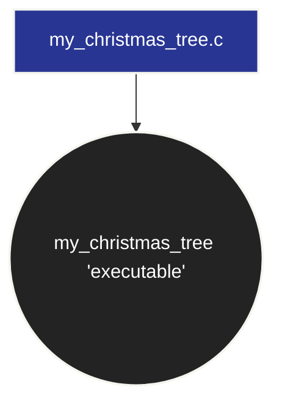

<p align="center">

</p>

<br />

<div align="center">

<a href="" target="_blank" rel="noopener">
  
</a>

</div>

<br />
<br />
<br />
<br />
<br />
<br />

<div align="center">

# Christmas Tree

<br />


<br/>

*"A picture of a Christmas tree"*

</div>

<br />
<br />

<div align="center">

## {🗂️}\ Summary

<br />

<h3>
  <a href="#context" style="text-decoration: none;">
    <kbd style="font-size: 0.9em; padding: 0.3em 0.6em; font-weight: bold;">Context</kbd>
  </a>
</h3>

<br />

<h3>
  <a href="#guide" style="text-decoration: none;">
    <kbd style="font-size: 0.9em; padding: 0.3em 0.6em; font-weight: bold;">Guide</kbd>
  </a>
</h3>

<br />

<h3>
  <a href="#more-information" style="text-decoration: none;">
    <kbd style="font-size: 0.9em; padding: 0.3em 0.6em; font-weight: bold;">More Information</kbd>
  </a>
</h3>

<br />

<h3>
  <a href="#download" style="text-decoration: none;">
    <kbd style="font-size: 0.9em; padding: 0.3em 0.6em; font-weight: bold;">Download</kbd>
  </a>
</h3>

<br />

<h3>
  <a href="#future" style="text-decoration: none;">
    <kbd style="font-size: 0.9em; padding: 0.3em 0.6em; font-weight: bold;">Future</kbd>
  </a>
</h3>

<br />

<h3>
  <a href="#credits" style="text-decoration: none;">
    <kbd style="font-size: 0.9em; padding: 0.3em 0.6em; font-weight: bold;">Credits</kbd>
  </a>
</h3>

<br />
<br />

> Clickable buttons!

</div>

<br />
<br />

<div align="center">

<h2 id="context">{📚}\ Context</h2>

</div>

<br />

> ---
>
> **Christmas Tree** is a **command-line interface (CLI) program** designed to **generate** and **display** scalable **ASCII** **Christmas trees** directly in the **terminal**.
>
> The **program accepts** a **numerical parameter** that determines the **size of the tree**. It calculates the dimensions of **each tier**, properly **aligns** the **foliage**, and **generates** a **centered trunk**.
>
> **Developed in C**, this project **demonstrates** fundamental **programming concepts**, including **loops**, conditional **statements**, **mathematical calculations**, modular **functions**, and **low-level output** operations using the **`write()` system call**.
>
> ---

<br />

<div align="center">


<br>

*"C Language Logo"*

<br />
<br />

<h2 id="guide">{📖}\ Guide</h2>

</div>

<br />

><a href="" target="_blank" rel="noopener">
>  
></a>
>
> <br />
>
> ### `my_christmas_tree.c`
>
> <br />
> <br />
>
> #### 1. Utility Functions
> <br>
>
> **`ft_putchar(char c)`**:
>
> This **function** uses the **low-level `write(1, &c, 1)`** system call to print a **single character** to **standard output** (**`stdout`**). The **file descriptor `1`** represents **standard output**. It is a **simple**, manual **implementation** of a **character-printing function**.
>
> <br />
>
> **`print_line(int spaces, int stars, char c)`**:
>
> This **helper function simplifies line printing** and **avoids code duplication**.
>
> It **first** prints the **required number** of **leading spaces** to **ensure proper horizontal alignment** and **centering**. It then **prints the specified character** (**`*` for the foliage** or **`|` for the trunk**) the **requested number of times**. **Finally**, it **prints a newline character (`\n`)**.
>
> <br />
> <br />
>
> #### 2. Main Entry Point and Argument Validation
> <br>
>
> **Argument Count Check (`argc != 2`)**:
>
> The **program requires** exactly **one command-line argument**: the **size** of the **tree**.
>
> If the **program is executed incorrectly** (for example, **without an argument or with multiple arguments**), it exits without displaying anything by **returning `0`**.
>
> <br />
>
> **Size Validation (`size <= 0`)**:
>
> The **argument** is converted into an **integer using `atoi()`**.
>
> If the specified **size is zero or negative**, the program **terminates immediately without printing anything**. This behavior **matches the expected output** for an **input of `0`** and **prevents unwanted loops** for **negative values**.
>
> <br />
> <br />
>
> #### 3. Calculating the Maximum Width (`max_width`)
> <br>
>
> To **center the tree correctly**, the program **first needs** to **determine the width** of its **bottom row**, which represents the **base of the foliage**.
>
> A **preliminary loop** simulates the structure of **each tier (`t`)**, from **top to bottom**, to calculate the **total number of rows** and the **number of stars** in the **final row**.
>
> The **variable `max_width` stores** the **width of the bottom row**. This value serves as a **reference** for **calculating** the **indentation** of **every preceding row** and the **trunk**.
>
> <br />
> <br />
>
> #### 4. Drawing the Foliage (Tiers)
> <br>
>
> The **program iterates** through each **tier (`t`)** and each **row (`r`)** within that tier.
>
> **For every row, it calculates**:
>
> - **Number of stars (`stars`)**: Determined by the **progression of the current tier**.
>
> - **Number of leading spaces (`spaces`)**: Calculated using **`(max_width - stars) / 2`** to ensure **symmetrical alignment relative** to the **bottom row**.
>
> - **Line rendering**: The **`print_line(spaces, stars, '*')`** function is **called to display the row**.
>
> <br />
> <br />
>
> #### 5. Drawing the Trunk
> <br>
>
> **Trunk Width (`trunk_width`)**:
>
> ```c
> int trunk_width = (size % 2 == 0) ? size + 1 : size;
> ```
>
> If the **size is even**, the **trunk width** is **increased** by one to obtain an **odd number** of **characters**. This ensures that the **trunk remains** centered **relative to the tree**.
>
> **Trunk Height and Rendering**:
>
> The **trunk height** is exactly **equal to the specified size**. For example, a **tree of size `5`** has a **trunk consisting** of **five lines**, each containing **five vertical bars (`|||||`)**.
>
> **The trunk is centered using the same spacing calculation**:
>
> `(max_width - trunk_width) / 2`
>
> <br />

```c
#include <unistd.h>
#include <stdlib.h>

void ft_putchar(char c) {
    write(1, &c, 1);
}

void print_line(int spaces, int stars, char c) {
    for (int i = 0; i < spaces; i++) {
        ft_putchar(' ');
    }
    for (int i = 0; i < stars; i++) {
        ft_putchar(c);
    }
    ft_putchar('\n');
}

int main(int argc, char **argv) {
    if (argc != 2) {
        return 0;
    }

    int size = atoi(argv[1]);
    if (size <= 0) {
        return 0;
    }

    int current_start = 1;
    int last_rows = 0;

    for (int t = 0; t < size; t++) {
        last_rows = 4 + t;
        if (t + 1 < size) {
            current_start = current_start + 2 * last_rows - 4;
        }
    }

    int max_width = current_start + 2 * (last_rows - 1);

    current_start = 1;

    for (int t = 0; t < size; t++) {
        int rows = 4 + t;

        for (int r = 0; r < rows; r++) {
            int stars = current_start + 2 * r;
            int spaces = (max_width - stars) / 2;
            print_line(spaces, stars, '*');
        }

        if (t + 1 < size) {
            current_start = current_start + 2 * rows - 4;
        }
    }

    int trunk_width = (size % 2 == 0) ? size + 1 : size;

    for (int i = 0; i < size; i++) {
        int spaces = (max_width - trunk_width) / 2;
        print_line(spaces, trunk_width, '|');
    }

    return 0;
}
```

<br />
<br />
<br />
<br />

<div align="center">

<h2 id="more-information">{🗞️}\ More Information</h2>

<br />

</div>

> ---
>
> **Beyond generating static ASCII patterns**, this project **demonstrates mathematical calculations**, **structured iteration**, and **low-level output management**.
>
> By relying directly on the **`write()` system call** instead of **standard library output** functions such as **`printf()`**, the **program maintains a simple and lightweight output mechanism**.
>
> The **codebase focuses on modularity, readability**, and **deterministic output**, providing a **practical introduction** to **procedural programming in C**.
>
> ---

<br />
<br />

> [!WARNING]
>
> **Compilation Workflow**:
> 
> <br />
>
> To **compile the program** with **strict compiler warnings**, execute the following **command in your terminal**:
>
> ```bash
> gcc -Wall -Wextra -Werror my_christmas_tree.c -o my_christmas_tree
> ```
> <br />
> <br />
> 
> To **remove** the **compiled executable**, run:
>
> ```bash
> rm my_christmas_tree
> ```

<br />
<br />

<div align="center">

<h2 id="download">{📥}\ Download</h2>

</div>

<br />

> ---
>
> #### Prerequisites
>
> Make sure that GCC is installed on your system.
>
> <br />
>
> <a href="https://code.visualstudio.com/docs/cpp/config-mingw" target="_blank" rel="noopener">
>  
> </a>
>
> <br />
> <br />
> <br />
> <br />
>
> **To compile the project**, execute the following terminal command:
>
> ```bash
> gcc -Wall -Wextra -Werror my_christmas_tree.c -o my_christmas_tree
> ```
>
> <br />
> <br />
> 
> **To execute the program**, run:
>
> ```bash
> ./my_christmas_tree <size>
> ```
>
> **Replace `<size>`** with the **desired tree size**.
>
> <br />
>
> On **Windows**, **depending** on your **compiler environment**, the **executable** can be **launched using**:
>
> ```bash
> ./my_christmas_tree.exe <size>
> ```
>
> <br />
> <br />
> 
> The **project** can also be **downloaded directly from GitHub**.
>
> ---

<br />
<br />
<br />


| File | Description |
|:---:|:---:|
| **my_christmas_tree.c** | The **main source file** containing the **program responsible** for **generating** and **displaying** the **Christmas tree** in the **terminal**. |

<br />
<br />
<br />

<div align="center">



*"Project Composition"*

</div>

<br />
<br />

<div align="center">

<h2 id="future">{🌌}\ Future</h2>

</div>

<br />

> ---
>
> **Future improvements** could **include ANSI color support** to introduce **dynamic Christmas-themed palettes**, **customizable ornaments (`o`, `+`, `*`)**, and **additional tree decorations**.
>
> **Another possible enhancement** would be to **develop an interactive terminal interface** using the **`ncurses` library**, allowing **users** to **customize the tree's appearance** and **dimensions in real time**.
>
> ---

<br />
<br />

<div align="center">

<h2 id="credits">{📌}\ Credits</h2>

</div>

<br />

<p align="center">

<a href="https://github.com/EliasFCS" target="_blank" rel="noopener">
  
</a>